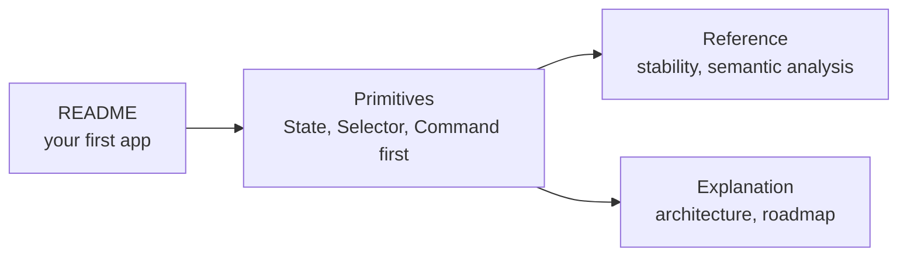

# NEXUS documentation

> **TL;DR:** NEXUS holds everything an application does (state, commands, services, events and device capabilities) and runs with no user interface attached. Start with the README's first app; come here for exact behavior and the reasons behind it.

## Prerequisites

* Some TypeScript and [Effect](https://effect.website): NEXUS adds application concepts on top of it.
* The [first app in the README](../README.md#your-first-app): state, one command, and a runtime.

---

## Where to go

## Reference

| Page | What it answers |
|---|---|
| [Primitives](reference/primitives/README.md) | The nine building blocks: what each is for, its API, errors and rules. Read State, Selector and Command first |
| [Semantic analysis](reference/semantic.md) | Describing an operation as plain data, `Semantic.build`, the IR and `Semantic.analyze` |
| [API stability](reference/stability.md) | What each public surface promises |
| [Release notes](reference/releases/) | Each version in full; the [changelog](../CHANGELOG.md) is the summary |

## Explanation

- [**Architecture**](explanation/architecture.md): the design reference: what each primitive is for and how the pieces fit together.
- [**Roadmap**](explanation/roadmap.md): v0.5 to v1.0, and what each release shipped.
- [**Future direction**](explanation/future-direction.md): where NEXUS is heading beyond the roadmap.

<b>The design record</b>

* Audits: [runtime and platform](explanation/design-records/2026-09-27-runtime-platform-audit.md), [capability model](explanation/design-records/2026-09-27-capability-model-audit.md), [application semantics](explanation/design-records/2026-09-27-application-semantics-audit.md), [VALANCE integration](explanation/design-records/2026-09-28-valance-integration-audit.md), and the [application fiber boundary](explanation/design-records/2026-09-28-j1-application-fiber-boundary.md).
* The [specs](explanation/specs/) and [implementation plans](explanation/plans/) each release was built from, and the [style conversion report](explanation/style-conversion-report.md).

## Next steps

* [State](reference/primitives/state.md), then [Selector](reference/primitives/selector.md) and [Command](reference/primitives/command.md).
* Working on NEXUS itself? See [Contributing](../CONTRIBUTING.md).
